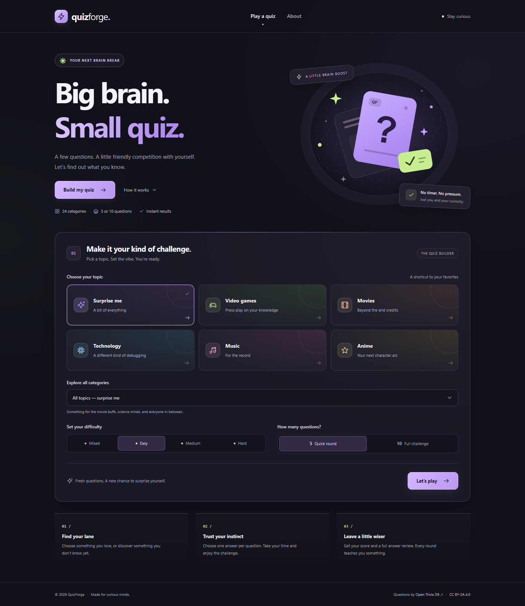
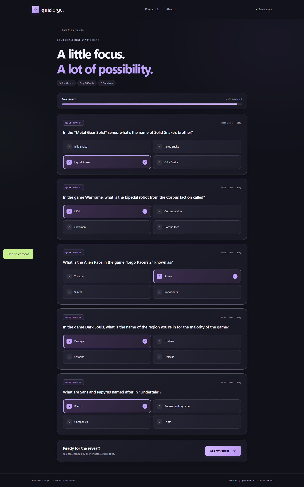
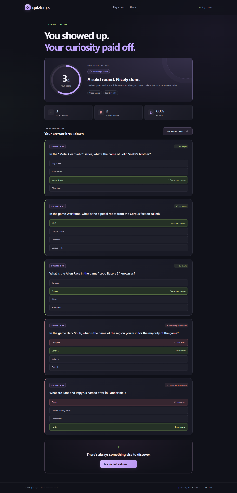

# QuizForge

**Big brain. Small quiz.** A server-rendered trivia application for the Web Development II individual project. Choose a topic, difficulty, and round length, answer the questions, and get a server-calculated score with a complete answer review.

**Student:** Tanatarov Danial · **Student ID:** 32291

## Features

- Live categories and multiple-choice questions from **[Open Trivia Database](https://opentdb.com/)**.
- Six quick topic shortcuts plus the full API category list.
- Mixed, Easy, Medium, or Hard difficulty; 5 or 10 questions.
- Answer choices shuffled on the server using Fisher–Yates.
- Server sessions keep the answer key out of the quiz HTML.
- Score, percentage, achievement label, and a question-by-question review.
- Responsive dark interface, labeled form controls, keyboard focus states, and a progress indicator.
- Color-coded topic cards, a softly animated hero with quick navigation, and rank-themed result panels; animations respect reduced-motion preferences.
- Server-side validation, friendly 404/API error pages, and centralized error handling.
- HTTP request logging, an eight-second API timeout, category caching, and API rate-limit handling.

## Requirements and installation

Use **Node.js 22 or newer** and npm. Internet access is needed when starting a live quiz.

Open a terminal in `Individual_Project/QuizForge` (the folder containing this README and its own `package.json`).

```sh
npm install
```

Copy `.env.example` to `.env` in your editor. Set:

```dotenv
PORT=3000
SESSION_SECRET=your-own-long-random-value
```

You can generate a session secret with:

```sh
node -e "console.log(require('node:crypto').randomBytes(32).toString('hex'))"
```

OpenTDB does **not** require an API key. The `.env` file must not be committed or included in the submission ZIP. Without `.env`, the app still starts on port 3000 and generates a temporary session secret.

```sh
npm start
```

Visit **http://localhost:3000**. To restart automatically after server-side edits:

```sh
npm run dev
```

If port 3000 is occupied, choose another port in `.env` and restart.

## Routes

| Method | Route | Purpose |
|---|---|---|
| GET | `/` | Load categories and render the quiz setup form |
| POST | `/quiz` | Validate settings, request questions, store the round in a session, render the quiz |
| POST | `/results` | Validate submitted answer IDs, calculate the result, redirect with HTTP 303 |
| GET | `/results` | Show the current session’s latest result; return home if no result exists |
| GET | `/about` | Explain the app, scoring, API limitations, and attribution |
| Any unmatched route | — | Render an EJS 404 page |

## Public API integration

Documentation: **https://opentdb.com/api_config.php**

Two distinct requests to the same public API are used:

1. `GET https://opentdb.com/api_category.php` — available category IDs and names.
2. `GET https://opentdb.com/api.php?amount=5&category=15&difficulty=easy&type=multiple&encode=url3986` — questions using the user’s form settings.

Category/difficulty parameters are omitted when the user selects All topics/Mixed. Axios performs all external requests on the server. `encode=url3986` and `decodeURIComponent` handle special characters; EJS then escapes question and answer text when generating HTML.

### Meaningful data processing

- Sort categories alphabetically and map selected IDs to readable names.
- Decode and validate the question payload.
- Shuffle correct and incorrect choices while retaining the correct answer ID on the server.
- Validate answers against the current session’s actual options.
- Count correct answers and calculate `Math.round(correct / total * 100)`.
- Assign a result label: below 50% **Curiosity unlocked**, 50–79% **Knowledge seeker**, 80–100% **Quiz legend**.
- Produce a review distinguishing the selected answer from the correct answer.

### API failures and limits

OpenTDB can return HTTP 200 with a nonzero `response_code`, so both HTTP and API-level failures are checked. Code 1 produces a helpful “try fewer questions” message; code 5/HTTP 429 requests a short wait. Network failures, timeouts, malformed/incomplete data, and upstream HTTP errors produce friendly pages rather than stack traces.

The API permits one question request per IP every five seconds. This app spaces question requests by at least 5.5 seconds and caches categories for six hours. Other applications sharing the same public IP can still trigger the upstream limit. Questions are community-contributed and may repeat between rounds; OpenTDB deduplication tokens are not used.

## Project structure and MVC

```text
QuizForge/
├── app.js                     # Express, EJS, dotenv, sessions, middleware, startup
├── routes/quiz-routes.js       # HTTP paths and controller wiring
├── controllers/quiz-controller.js
├── services/trivia-service.js  # Axios, API payload validation, cache and error translation
├── middleware/                # Request logger, form validation, 404 and error handler
├── utils/                     # Shuffle, answer validation, grading, operational errors
├── views/                     # Home, quiz, results, about, error
│   └── partials/              # Shared header, footer and SVG icon include
├── public/                    # CSS, progressive-enhancement JS, custom SVG illustrations
├── test/                      # Scoring, HTTP/session flow and simulated API failure tests
├── docs/                      # Proposal, Canvas post, declaration, defense guide, screenshots
├── .env.example
├── .gitignore
├── package.json
└── package-lock.json
```

The **model/data side** consists of API services, quiz transformation functions, and session data. Controllers coordinate them, while EJS views present the result. This MVC-style application does not need a database.

`express-session` uses an in-memory store for this individual/local-demo project. The cookie contains a signed session identifier, not the answer key. A session retains one active quiz and one latest result for up to two hours; restarting the server clears the store. The post/redirect/get flow makes refreshing results safe, and a repeated submission of the same completed round returns the stored result.

## Tests

```sh
npm test
```

The Node.js test runner and Supertest cover:

- Correct and partial scores, ranking thresholds, shuffled option/answer associations.
- Complete form → quiz → result flow, refreshes, duplicate submissions, and session isolation.
- Missing, duplicated, and invented answer IDs; invalid settings and replaced rounds.
- Escaped question content and the absence of the answer key in the quiz page.
- API response codes, malformed data, timeouts, HTTP failures, disconnected sockets, and cooldowns.
- Friendly 404 pages and hiding internal error details from users.

These tests use simulated API responses/local HTTP servers and do not consume the public API’s request allowance. Error-path tests deliberately log technical diagnostics; use the final pass/fail summary to interpret the run. See [the checklist](docs/CHECKLIST.md) for manual checks and the separate live-browser verification.

## Screenshots

Actual application pages captured using a live OpenTDB round. Content changes from quiz to quiz.

### Quiz builder


### Answering questions


### Result and answer review


## Assignment documents

- [API choice discussion post](docs/API_CHOICE.md) — first confirm OpenTDB is not already assigned in your group.
- [Project proposal](docs/PROPOSAL.md) — draft for the Week 9 submission.
- [AI Declaration](docs/AI_DECLARATION.md) — includes actual assistant involvement; student fields still need completion.
- [Russian defense guide](docs/DEFENSE_GUIDE.ru.md) — request flow, important concepts, and live-edit practice.
- [Russian Git/GitHub guide](docs/GIT_GUIDE.ru.md) — first commit, pushing, and timing relative to submission.
- [Personal verification worksheet](docs/MY_CHECKS.ru.md) — record checks and edits you actually perform yourself.
- [Submission and verification checklist](docs/CHECKLIST.md).

The repository must show at least **8 meaningful commits on different actual days**. A Git repository has been initialized; commit your real work as it happens. The generated starting code is not a substitute for a genuine development history.

## Credits and AI assistance

Trivia content: **Open Trivia DB**, [CC BY-SA 4.0](https://creativecommons.org/licenses/by-sa/4.0/). Questions are decoded, answer choices shuffled, and results formatted into a review. Source/license links are also displayed in the application.

Reference documentation: [Express](https://expressjs.com/), [Axios](https://axios-http.com/docs/intro), [EJS](https://ejs.co/), [express-session](https://github.com/expressjs/session), [dotenv](https://github.com/motdotla/dotenv), [Node.js test runner](https://nodejs.org/api/test.html).

The OpenCode AI assistant helped plan the application and create the initial implementation, SVGs, styles, tests, and documentation. Review the code and complete the declaration honestly before submission. Preserve the AI conversation and drafts for 30 days after final grades, as required by the assignment.
